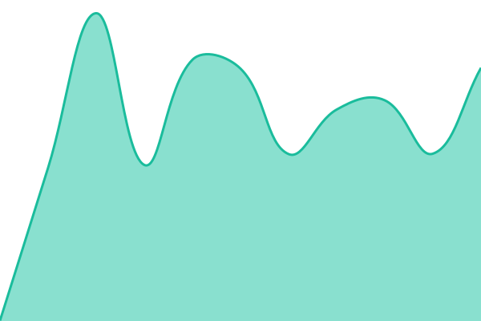
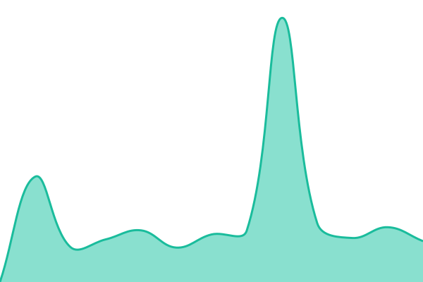
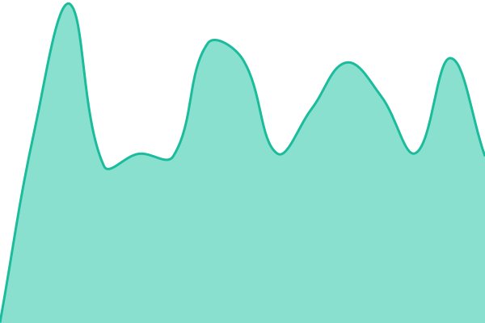

# [📈 Live Status](https://quividi.github.io/status): <!--live status--> **🟩 All systems operational**

This repository contains the open-source uptime monitor and status page for [quividi](https://quividi.github.io/status), powered by [Upptime](https://github.com/upptime/upptime).

With [Upptime](https://upptime.js.org), you can get your own unlimited and free uptime monitor and status page, powered entirely by a GitHub repository. We use [Issues](https://github.com/quividi/status/issues) as incident reports, [Actions](https://github.com/quividi/status/actions) as uptime monitors, and [Pages](https://quividi.github.io/status) for the status page.

<!--start: status pages-->
<!-- This summary is generated by Upptime (https://github.com/upptime/upptime) -->
<!-- Do not edit this manually, your changes will be overwritten -->
<!-- prettier-ignore -->
| URL | Status | History | Response Time | Uptime |
| --- | ------ | ------- | ------------- | ------ |
|  [VidiCenter](https://vidicenter.quividi.com/healthz/) | 🟩 Up | [vidi-center.yml](https://github.com/quividi/status/commits/HEAD/history/vidi-center.yml) | 

 572ms
     
 | 

<a href="https://status.quividi.com/history/vidi-center">99.68%</a>
    

|  [VidiReports API](https://api.quividi.com/v1/upload) | 🟩 Up | [vidi-reports-api.yml](https://github.com/quividi/status/commits/HEAD/history/vidi-reports-api.yml) | 

 795ms
     
 | 

<a href="https://status.quividi.com/history/vidi-reports-api">99.85%</a>
    

|  [Cloud API](https://vidicenter.quividi.com/api/v1/whoami/) | 🟩 Up | [cloud-api.yml](https://github.com/quividi/status/commits/HEAD/history/cloud-api.yml) | 

 526ms
     
 | 

<a href="https://status.quividi.com/history/cloud-api">99.90%</a>
    

|  [Quiotto](https://quiotto.quividi.com/login/) | 🟩 Up | [quiotto.yml](https://github.com/quividi/status/commits/HEAD/history/quiotto.yml) | 

 841ms
     
 | 

<a href="https://status.quividi.com/history/quiotto">99.73%</a>
    

|  [MCP server](https://mcp.quividi.com/mcp) | 🟩 Up | [mcp-server.yml](https://github.com/quividi/status/commits/HEAD/history/mcp-server.yml) | 

 503ms
     
 | 

<a href="https://status.quividi.com/history/mcp-server">99.99%</a>
    

<!--end: status pages-->

[**Visit our status website →**](https://quividi.github.io/status)

## 📄 License

- Powered by: [Upptime](https://github.com/upptime/upptime)
- Code: [MIT](./LICENSE) © [Anand Chowdhary](https://anandchowdhary.com)
- Data in the `./history` directory: [Open Database License](https://opendatacommons.org/licenses/odbl/1-0/)
